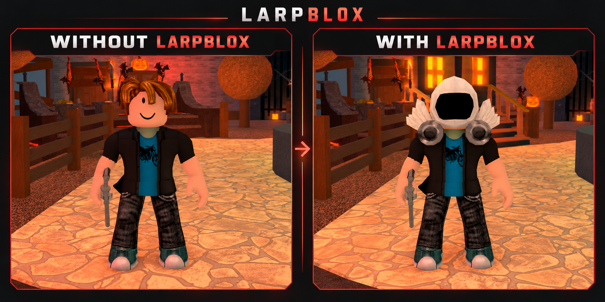

<p align="center">
  
</p>

<p align="center">be who you never will.</p>



## Features

- Edit accessories, clothes, skin, body parts, emotes, and movement animations.
- Save and switch between character looks.
- Pair with the browser wardrobe for outfit sync and optional Larp names.
- Share supported appearances with Larpblox users in the same live server.

> [!NOTE]
> Appearance changes affect your local client. Enable **Share appearance** on the browser's Avatar page to share supported looks with other Larpblox users in the same server. Both players must enable sharing. A custom Larp name is optional.

<details>
<summary>Murder Mystery 2</summary>

Local inventory, weapon, and effect previews. They do not grant ownership. See the [user guide](docs/guide.md#mm2-local-cosmetics).

</details>

## Load

Run in a compatible Roblox client executor:

The interface uses [Prism](https://github.com/3xjn/prism) with Larpblox's classic styling. The executor needs local file and asset support (`writefile` and `getcustomasset` or `getsynasset`).

```lua
local branch = "main"
loadstring(game:HttpGet("https://raw.githubusercontent.com/noahkcarmstrong-ops/larpblox/" .. branch .. "/launcher.lua", false))(branch)
```

## Companion apps

- [Larpblox Desktop](https://github.com/3xjn/larpblox-desktop/releases) — Windows installer for the local browser/game connection.
- [Browser extension](https://github.com/3xjn/larpblox-extension/releases) — maintained and downloaded separately.

## Documentation

- [User guide](docs/guide.md)


### Avatar diagnostics

Executor logs are written to `logs/larp/latest.log`; the previous session is archived when a new session starts. Loading and generation operations have paired `operation_start` / `operation_finish` records with unique operation IDs, parent IDs for nested calls, player/asset context, elapsed milliseconds, and errors. Starts and finishes are flushed immediately. Normal mode records individual mesh/accessory mutations only on failure or when they take at least 16 ms; verbose mode includes their paired checkpoints. An unfinished operation identifies a call that was in progress when logging stopped, not proof that it caused a crash. Interface teardown records unfinished operations as cancelled.

For deeper captures, configure the shared options table before loading the interface:

```lua
getgenv().larpblox = {
    diagnostics = {
        verbose = true,
    },
}
```

During a session, change `getgenv().larpblox.diagnostics.verbose` directly; initialization preserves existing options. Verbose mode adds Lua memory, total client memory, instance counts, and individual mesh-application checkpoints. Set it to `false` to return to normal logging. Stats are sampled at operation boundaries only; there is no recurring sampler. Verbose logging adds disk writes and should be used for diagnosis rather than performance benchmarking.
