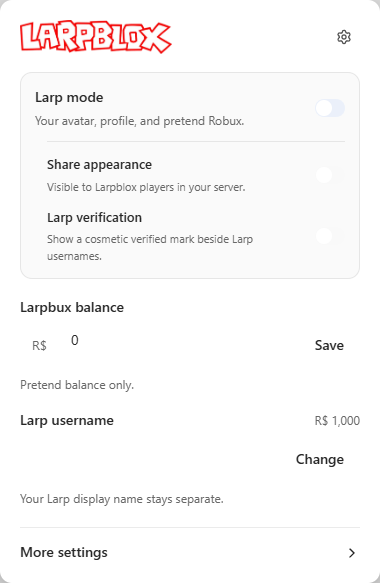
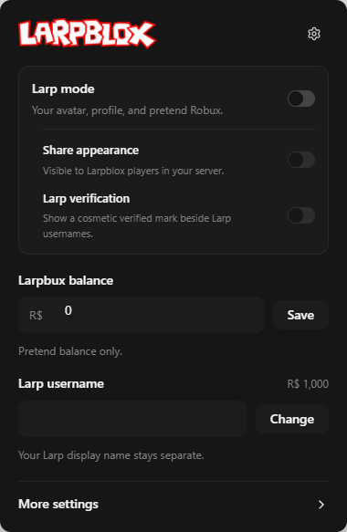

# Larpblox userscript

The Larpblox userscript adds the browser-side Larp mode menu to Roblox. It saves your browser settings in the same profile you already use, and it leaves Roblox's built-in menu icons, keyboard hints, separators, and voice-chat indicators alone.

## Install in four small steps

1. Disable the old Larpblox extension if installed, then install [Tampermonkey](https://www.tampermonkey.net/) (recommended) or [Violentmonkey](https://violentmonkey.github.io/get-it/).
2. Click the **Install userscript** button above.
3. Approve the script in your manager, then reload your Roblox tab.
4. Open the userscript manager menu and choose **Open Larpblox**.

The manager checks for updates automatically, but an update may take a little time to appear. You can open the install link again when you want to check immediately.

This setup has been tested with Tampermonkey 5.5.1 and Violentmonkey 2.49.0 in separate Chrome for Testing 156 profiles. In the test fixture, the manager menu opened the popup, the native Roblox hooks initialized, and the localhost WebSocket authenticated and sent a Desktop message. This verifies the browser and fixture path; it does not verify every browser or a live game.

 

The settings panel follows Roblox’s light or dark mode.

## Browser managers

| Browser | Recommended manager |
| --- | --- |
| Chrome, Edge, Opera | [Tampermonkey](https://www.tampermonkey.net/) or [Violentmonkey](https://violentmonkey.github.io/get-it/) |
| Firefox | [Tampermonkey](https://www.tampermonkey.net/) or [Violentmonkey](https://violentmonkey.github.io/get-it/) |
| Safari | Manager support is not documented for this release |
| Greasemonkey | Not supported yet; use Tampermonkey or Violentmonkey on Firefox |

If the old Larpblox extension is installed, disable it once before using the userscript so both versions do not add the same browser features. Your saved settings are reused when the userscript runs in the same browser profile.

The [Larpblox Desktop helper](https://github.com/3xjn/larpblox-desktop/releases) is still required for in-game outfit and name synchronization. The userscript handles the Roblox website menu; Desktop handles the local game connection. Desktop uses a hidden localhost frame and manager-private storage messaging, so you do not need to open a manual localhost tab or upgrade Desktop for this setup.

### Chrome Local network permission

New Chrome 156 profiles may ask for Local network access when Roblox uses Desktop. Click **Allow**. If the request was blocked, open Roblox's address-bar site controls, choose **Site settings**, set **Local network access** to **Allow**, and refresh Roblox.

## If the link downloads code instead of opening your manager

1. Check that Tampermonkey or Violentmonkey is enabled in your browser.
2. Open the manager's setup page once, then click the install link again.

You can also use the [raw userscript link](https://github.com/3xjn/larpblox-extension/releases/download/main-latest/larpblox.user.js) from the manager's **Install from URL** option.

## More examples

These public projects use clear manager links, browser tables, screenshots, or raw-script fallbacks that inspired this guide:

- [XIU2/UserScript README](https://github.com/XIU2/UserScript/blob/master/README.md)
- [Undiscord README](https://github.com/victornpb/undiscord/blob/master/README.md)
- [Telegram Media Downloader README](https://github.com/Neet-Nestor/Telegram-Media-Downloader/blob/main/README.md)
